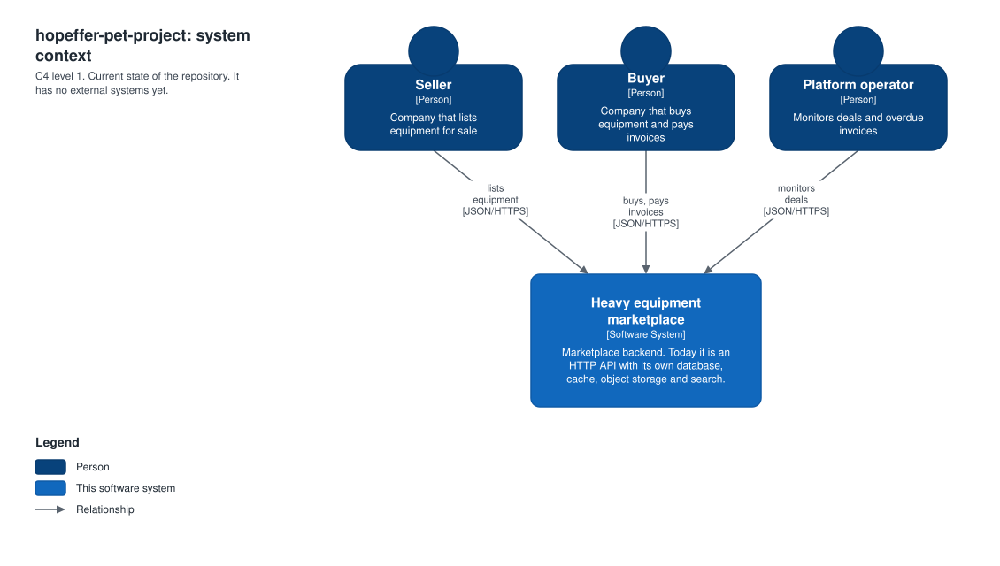
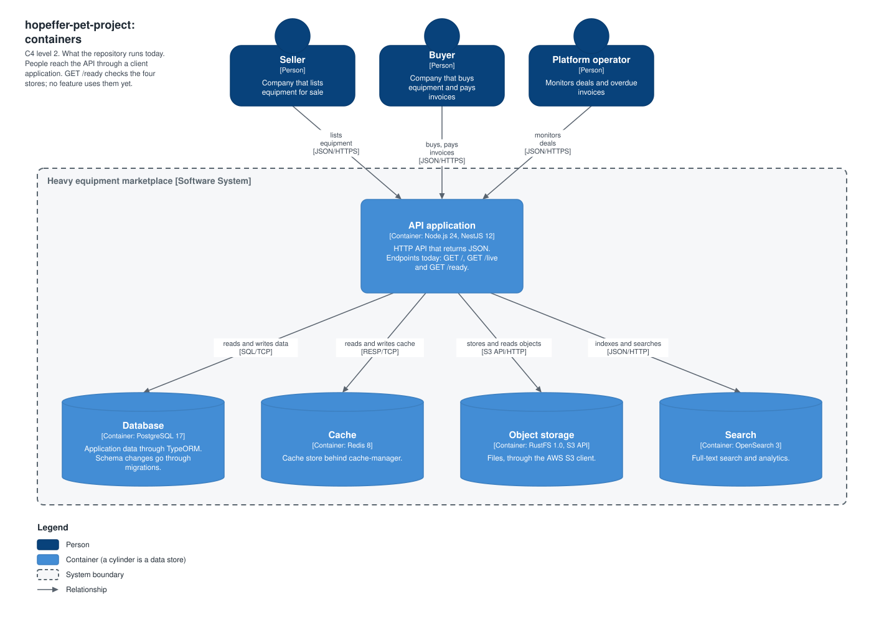
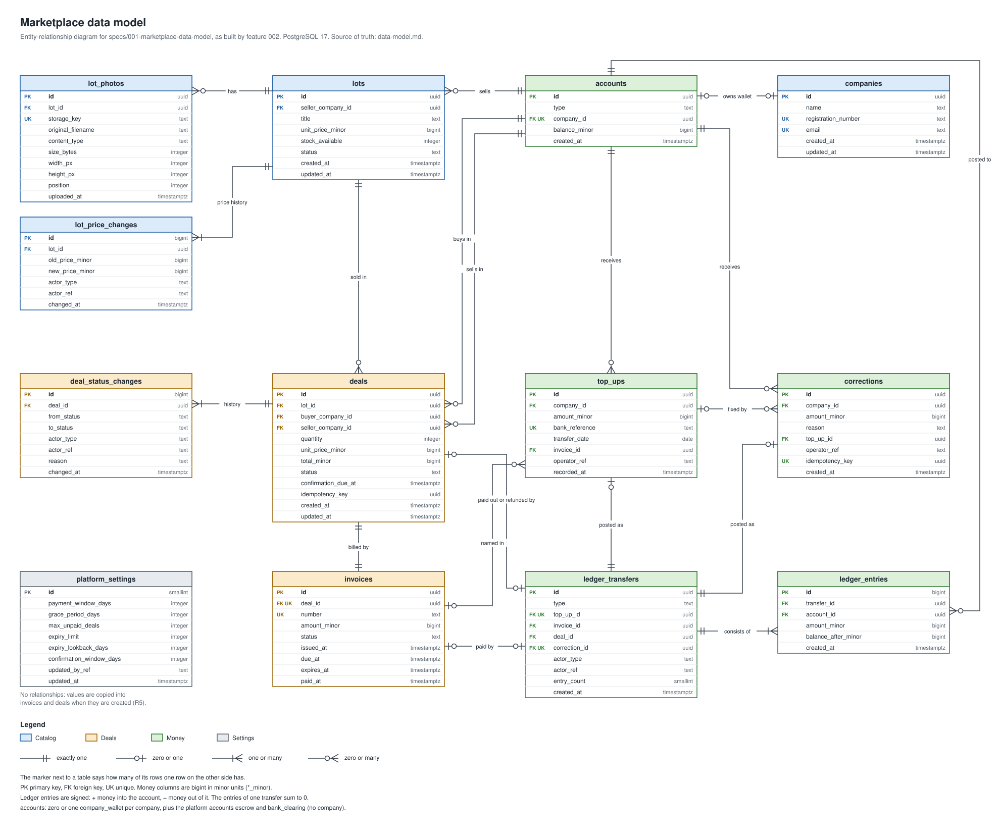

# hopeffer-pet-project

NestJS backend service.

## Architecture

C4 diagrams of what this repository has today. Each `.drawio.svg` file is both the picture and the source: open it in [draw.io](https://app.diagrams.net/) to edit it.

System context: who uses the system. It has no external systems yet.



Containers: what the system consists of today. `docker-compose.yml` runs the four backing services. `GET /ready` checks them, and no feature uses them yet.



Data model: the marketplace tables exist in PostgreSQL, created by the migrations in `src/database/migrations/`, but no feature uses them yet. The rules and the reasons behind them are in [`specs/001-marketplace-data-model/data-model.md`](specs/001-marketplace-data-model/data-model.md).



Everything that is planned is in a separate case: [Marketplace v2](docs/system-design/marketplace-v2/README.md) (previous version: [v1](docs/system-design/marketplace-v1/README.md)).

## Tech stack decisions

| Area            | Choice                                                                                                                                     | Why                                                                                                                                                               |
| --------------- | ------------------------------------------------------------------------------------------------------------------------------------------ | ----------------------------------------------------------------------------------------------------------------------------------------------------------------- |
| Framework       | [NestJS](https://nestjs.com/)                                                                                                              | Structured, opinionated Node.js framework; built-in DI, module system, testing support                                                                            |
| Runtime         | [Node.js](https://nodejs.org/) 24 LTS                                                                                                      | Current Active LTS; `engines.node` in `package.json` tells CI and hosts which Node to use; `devEngines.runtime` blocks local installs and scripts on older Node   |
| Package manager | [pnpm](https://pnpm.io/) 12                                                                                                                | Fast installs, disk-efficient via content-addressable store, strict dependency resolution                                                                         |
| Language        | TypeScript                                                                                                                                 | Type safety, matches NestJS defaults                                                                                                                              |
| Configuration   | [@nestjs/config](https://docs.nestjs.com/techniques/configuration) + [zod](https://zod.dev/)                                               | Standard Nest configuration: loads `.env`, and the zod schema stops the app at startup when a setting is missing or malformed                                     |
| Test runner     | [Vitest](https://vitest.dev/)                                                                                                              | Fast, native ESM support, Jest-compatible API                                                                                                                     |
| Formatter       | [Prettier](https://prettier.io/)                                                                                                           | Consistent code style, no formatting debates                                                                                                                      |
| ORM / database  | [TypeORM](https://typeorm.io/) via [@nestjs/typeorm](https://docs.nestjs.com/techniques/database) + PostgreSQL                             | Decorator-based entities that fit Nest's DI, repository injection per module, migration CLI built in                                                              |
| Cache           | Redis via [@nestjs/cache-manager](https://docs.nestjs.com/techniques/caching) + [@keyv/redis](https://github.com/jaredwray/keyv)           | Standard Nest caching abstraction, backed by Redis                                                                                                                |
| Object storage  | [RustFS](https://github.com/rustfs/rustfs) via the AWS SDK [`@aws-sdk/client-s3`](https://www.npmjs.com/package/@aws-sdk/client-s3)        | S3-compatible object storage under Apache 2.0 that runs locally; the app uses the standard AWS S3 client, so production can point it at any S3-compatible service |
| Search          | [OpenSearch](https://opensearch.org/) via [`@opensearch-project/opensearch`](https://www.npmjs.com/package/@opensearch-project/opensearch) | Full-text search / analytics, Elasticsearch-compatible API, open-source license                                                                                   |
| Logging         | [Pino](https://getpino.io/) via [nestjs-pino](https://github.com/iamolegga/nestjs-pino)                                                    | Fast structured JSON logs, automatic request logging with a request ID on every line                                                                              |
| Local infra     | [Docker Compose](https://docs.docker.com/compose/)                                                                                         | One command to run Postgres + Redis + RustFS + OpenSearch for local development                                                                                   |
| Secret scanning | [TruffleHog](https://github.com/trufflesecurity/trufflehog) (Docker image)                                                                 | Blocks `git push` if a commit being pushed contains a credential; scans all history of the checked-out commit in `pnpm run ci`                                    |

### Linting: ESLint vs Oxlint

Two linters run at different stages, each for a different purpose:

- **ESLint** — full check, runs in CI/CD. Type-aware rules (`typescript-eslint` with `recommendedTypeChecked`), [eslint-plugin-security](https://github.com/eslint-community/eslint-plugin-security) for common vulnerability patterns, [eslint-plugin-import](https://github.com/import-js/eslint-plugin-import) + [eslint-plugin-unused-imports](https://github.com/sweepline/eslint-plugin-unused-imports) for import hygiene, Prettier integration, Vitest-specific rules for test files. Catches everything before merge.
- **Oxlint** — fast, local-only check, runs on the pre-commit hook via [Husky](https://typicode.github.io/husky/). Catches obvious mistakes before commit without slowing down the commit itself.

Commands:

```bash
pnpm run lint          # oxlint — fast, local, pre-commit
pnpm run lint:eslint   # eslint — full, CI/CD
```

On commit, [lint-staged](https://github.com/lint-staged/lint-staged) runs `oxlint --fix` and `prettier --write` on staged `*.ts` files via the Husky `pre-commit` hook.

### Commit messages: Commitlint

Commit messages follow [Conventional Commits](https://www.conventionalcommits.org/) (`type(scope?): subject`), enforced by [Commitlint](https://commitlint.js.org/) on the Husky `commit-msg` hook.

`pnpm run commitlint:check` checks every commit on the current branch that `origin/main` does not have. It runs in `pnpm run ci`, so commits made with `--no-verify` or in the GitHub web UI are still checked.

```
feat: add user login endpoint
fix(auth): handle expired refresh token
chore: bump dependencies
```

Allowed types: `feat`, `fix`, `docs`, `style`, `refactor`, `perf`, `test`, `build`, `ci`, `chore`, `revert`.

### Configuration: @nestjs/config

`ConfigModule` (registered globally in `AppModule`) reads the settings from environment variables and, when the file exists, from `.env`. Real environment variables win over `.env`, so containers and CI set them directly. An empty value counts as unset. At startup the values are validated against the zod schema in `src/config/env.ts`: the app refuses to start and lists every missing or invalid variable, instead of silently connecting to the wrong place. `.env.example` documents every setting with the local values.

Services read settings by injecting `ConfigService<Env, true>` and calling `config.get('NAME', { infer: true })`. The TypeORM CLI (`src/database/data-source.ts`) runs outside Nest, so it loads `.env` itself and validates only `DATABASE_URL`, with the same schema.

### Database: TypeORM + PostgreSQL

`DatabaseModule` (`src/database/database.module.ts`) registers `TypeOrmModule.forRootAsync` with the connection string from `DATABASE_URL` and a pool of `DB_POOL_SIZE` connections per instance (default 10). With several replicas, keep replicas × `DB_POOL_SIZE` under the server's `max_connections`. `autoLoadEntities` is on, so each feature module registers its entities with `TypeOrmModule.forFeature([...])` and injects repositories with `@InjectRepository()`. `synchronize` is off: schema changes go through migrations.

Migrations live in `src/database/migrations/`. The TypeORM CLI uses `src/database/data-source.ts` and runs against the compiled `dist/` output, so every migration script except `migration:create` builds first.

```bash
pnpm run migration:generate src/database/migrations/<Name>   # diff entities vs DB into a new migration
pnpm run migration:create src/database/migrations/<Name>     # empty migration
pnpm run migration:run                                       # apply pending migrations
pnpm run migration:revert                                    # undo the last migration
```

### Cache: Redis

`RedisCacheModule` (`src/cache/redis-cache.module.ts`) registers Nest's `CacheModule` globally with a `@keyv/redis` store, connection string in `REDIS_URL`. Inject `CACHE_MANAGER` where caching is needed.

### Object storage: RustFS

`S3Service` (`src/s3/`) extends the AWS SDK's `S3Client` directly, configured from `S3_ENDPOINT`/`S3_REGION`/`S3_ACCESS_KEY`/`S3_SECRET_KEY`, exported globally via `S3Module`. For AWS S3, leave `S3_ENDPOINT` unset, and leave `S3_REGION` unset to use `AWS_REGION`. Leave both keys unset to let the SDK find credentials itself (`AWS_*` env vars, IRSA or workload identity, container or instance role); setting only one of them stops the app at startup. With `S3_ENDPOINT` set it uses path-style URLs (`host/bucket/key`), which self-hosted S3 servers expect. Locally it talks to [RustFS](https://github.com/rustfs/rustfs); MinIO no longer publishes Docker images. Console at `http://localhost:9001` (default creds `rustfsadmin`/`rustfsadmin`). The `/ready` check calls `ListBuckets`, so on AWS the app's role needs `s3:ListAllMyBuckets`; without it, no pod becomes ready.

### Search: OpenSearch

`OpensearchService` (`src/opensearch/`) extends the official client's `Client` directly, configured from `OPENSEARCH_NODE`, exported globally via `OpensearchModule`. For a secured cluster, set `OPENSEARCH_USERNAME` and `OPENSEARCH_PASSWORD` together for basic auth, and `OPENSEARCH_CA_CERT` to the PEM text of the CA when a public CA did not sign the cluster's certificate (a one-line value may use `\n` for line breaks). Local Compose instance runs with the security plugin disabled (dev only).

### Logging: Pino

`LoggerModule` (`src/logger/logger.module.ts`) plugs [nestjs-pino](https://github.com/iamolegga/nestjs-pino) in as the Nest logger. Why Pino over Nest's built-in `ConsoleLogger` or Winston: it is the fastest Node.js logger, it writes JSON lines to stdout that a collector can ship to OpenSearch as they are, and `pino-http` logs every request and attaches the request ID to every log line made while handling it.

The app writes logs to stdout only. The platform collects them: Docker, Kubernetes and systemd all capture stdout, and a log agent ships it to the log backend. Output is pretty-printed with `pino-pretty` in a terminal, and JSON lines when `NODE_ENV=production` or stdout is not a TTY. Set the level with `LOG_LEVEL` (default `info`, `silent` under tests).

Every JSON line has the same fields:

```json
{
  "level": "info",
  "time": "2026-10-10T14:06:02.162Z",
  "service": "hopeffer-pet-project",
  "version": "abc1234",
  "env": "staging",
  "pid": 1,
  "hostname": "api-7d9f",
  "reqId": "lb-42",
  "context": "OrdersService",
  "orderId": 7,
  "msg": "Order created"
}
```

- `level` is a label (`info`, `warn`, `error`, `fatal`) and `time` is an ISO timestamp, so Loki, ELK and Datadog need no mapping rule.
- `service` is the `package.json` name. `version` is `APP_VERSION` (set it to what the deploy runs: a git SHA or an image tag), or the `package.json` version. `env` is `APP_ENV` (the name of the deployment, for example `staging`), or `NODE_ENV`.
- `reqId` is the request ID. The app reuses the `x-request-id` header of the request when it is 1 to 128 characters of `A-Z a-z 0-9 . _ -`, and creates a UUID otherwise. It sends the ID back in the `x-request-id` response header, so a user can report it. One exception: a request that the body parser rejects (malformed JSON, a body over the size limit) is answered before the logger runs, so it gets no request ID and no request line.

**Request lines.** `pino-http` writes one line per request when the response is sent, with `req`, `res` and `responseTime`. The level is `error` for a 5xx or a failed response stream, `warn` for a 4xx, and `info` otherwise. A passing `/live` or `/ready` probe is not logged, and a failing one is logged at `warn`. The line that names the failed check (`Health Check has failed!`) is at `warn` too, so an outage of a backing service does not page through the probes.

**What is never logged.** Request and response headers come from the allowlists in `src/logger/serializers.ts`, so `Authorization`, `Cookie`, `Set-Cookie` and any header nobody listed stay out of the logs. Query string values are replaced with `[Redacted]`; the parameter names stay. Request bodies are not logged. An error under the `err` key is logged with a fixed set of fields (`type`, `message`, `stack`, `code`, the HTTP status and what Postgres says about the failed object; the list is in `src/logger/serializers.ts`). So the parameters of a failed query, and the request that a client library attaches to its error, stay out of the logs, also on the crash line. The SQL of a failed query is cut at 2000 characters.

**Crashes.** An error that stops the app (an invalid environment, a failed start, an uncaught exception, an unhandled promise rejection) is written as one `fatal` JSON line by `src/logger/crash.ts`, and the process exits with code 1. In a developer terminal the error is printed as plain text instead.

**Backing services.** TypeORM logs through the same logger (`src/database/typeorm.logger.ts`): a failed query and a query slower than `DB_SLOW_QUERY_MS` (default 500, 0 turns it off) at `warn`, and every query at `debug`, always without the query parameters. Redis client errors are logged at `error`, at most one line every 10 seconds.

**Logging in your code.** Use Nest's `Logger` from `@nestjs/common` (`private readonly logger = new Logger(MyService.name)`). Its output goes through Pino and carries the request ID. Pass the data as fields, not inside the message, and pass an error as `err`:

```ts
this.logger.log({ msg: 'Order created', orderId });
this.logger.error({ msg: 'Payment failed', err, orderId });
```

### Local infra: Docker Compose

`docker-compose.yml` runs Postgres, Redis, RustFS and OpenSearch for local development, matching the default `.env` connection strings. Every image is pinned to a version and its digest, so a retagged or compromised upstream image cannot change what runs. Dependabot proposes updates; keep the Postgres and Redis pins in `test/setup/global-setup.ts` the same.

```bash
pnpm run docker:up     # start postgres + redis + rustfs + opensearch in the background
pnpm run docker:down   # stop and remove them
```

### Secret scanning: TruffleHog

`.husky/pre-push` runs [TruffleHog](https://github.com/trufflesecurity/trufflehog) (via its Docker image, no local install needed) over the commits being pushed and blocks the push if it finds a credential. Requires Docker running locally.

`pnpm run secrets:scan` scans every commit reachable from `HEAD` (other branches are ignored) and runs in `pnpm run ci`. Both use `scripts/trufflehog.sh`, which pins the image by version and digest and runs it locked down: read-only repo mount, non-root user, no capabilities, read-only filesystem. The comments in the script explain each choice.

### CI: GitHub Actions

`.github/workflows/ci.yml` runs `pnpm run ci` on pull requests and pushes to `main`, so CI and local checks are the same command. Actions are pinned by commit SHA; Dependabot (`.github/dependabot.yml`) proposes updates after a 3-day cooldown.

## Prerequisites

- [Node.js](https://nodejs.org/) 24. An older Node fails `pnpm install`.
- [pnpm](https://pnpm.io/installation) 12, for example `npm install --global pnpm@12`. Any 12.x works: pnpm switches itself to the exact version that `pnpm-lock.yaml` records. pnpm 10 and older do not, and install with the wrong version.
- [Docker](https://docs.docker.com/get-docker/) with Compose, running. It hosts the backing services, the e2e test containers and the TruffleHog scan in the `pre-push` hook.

## Project setup

```bash
git clone https://github.com/adadychanka/hopeffer-pet-project.git
cd hopeffer-pet-project
pnpm install              # also installs the git hooks
cp .env.example .env      # local settings; the defaults match docker-compose.yml
pnpm run docker:up        # postgres, redis, rustfs, opensearch
pnpm run migration:run    # apply the database migrations
```

## Run

```bash
pnpm run start:dev              # watch mode
curl http://localhost:3000/     # {"message":"Hello World!"}
curl http://localhost:3000/live    # liveness: no dependency checks
curl http://localhost:3000/ready   # readiness: 503 if postgres, redis, rustfs or opensearch is down

pnpm run build && pnpm run start:prod   # production build
```

The app reads `.env` from the current directory. Without it, or with a setting missing, it stops at startup and names the variables to fix.

## Shutdown

On SIGTERM, `/ready` answers 503 for `SHUTDOWN_DRAIN_MS` (default 5000) while the app still serves, so the load balancer stops sending traffic. `/live` stays 200, so Kubernetes does not restart the pod. Then the server stops taking connections, finishes the requests in flight, closes Postgres, Redis, S3 and OpenSearch, and exits with code 0. Ctrl+C (SIGINT) skips the drain wait. `start:dev` restarts the app with SIGTERM on every rebuild, so set `SHUTDOWN_DRAIN_MS=0` in your local `.env` (as `.env.example` does), or each reload waits the full drain. In Kubernetes, keep `terminationGracePeriodSeconds` (default 30 s) well above `SHUTDOWN_DRAIN_MS`: a request that never finishes holds the shutdown until Kubernetes kills the pod, and keep-alive connections can add up to 5 s.

## Run in a Docker sandbox

Why Docker Sandboxes: they are easy to set up and run, and ship ready-made images for Claude Code. They still isolate the agent from the host well. Credentials such as the GitHub token stay on the host, and the sandbox proxy injects them, so they are never stored inside the sandbox. Network access is easy to control. Machine resources have no fixed static limits, so the developer experience is close to native development. For local development, this is the best option I found.

The project can be developed inside a [Docker Sandbox](https://docs.docker.com/ai/sandboxes/) together with a coding agent (e.g. Claude Code). The sandbox gets its own Docker daemon, so `pnpm run docker:up` starts Postgres, Redis, RustFS and OpenSearch inside it, and `localhost` in `.env.example` works unchanged. From the project root on the host, start the agent with `sbx run claude`. By default the working tree is mounted directly, so edits and commits show up on the host immediately. With `--clone` the sandbox works on a separate clone instead, and you fetch its commits with `git fetch sandbox-<name>`. The sandbox image ships Node 22 and no pnpm, so install the toolchain first with `sh scripts/sandbox-setup.sh` (Node 24 from nodejs.org, checked against its SHA-256 sums, and pnpm 12). Then follow [Project setup](#project-setup) from `pnpm install` on. The app listens on port 3000 inside the sandbox; to reach it from the host, publish the port from a host terminal:

```bash
sbx run claude                                    # start the agent in a sandbox for this repo
sbx ports <sandbox-name> --publish 3000:3000/tcp  # expose the Nest app on host port 3000
sbx secret set github --sandbox <sandbox-name>    # GitHub access from the sandbox (PAT, see below)
```

The sandbox name is shown by `sbx ls` (or `echo $SANDBOX_NAME` inside the sandbox). It is `claude-<folder>` for the first sandbox of a folder, and later ones get a suffix such as `claude-hopeffer-pet-project-1`, so check it rather than copying a name. Outbound network access is deny-by-default: if `pnpm install` or another request is blocked, allow the domain with `sbx policy allow network <domain>`. The TruffleHog pre-push hook uses the sandbox's Docker daemon, so `git push` works from inside the sandbox.

Disable SSH agent forwarding for the sandbox by setting `ssh.agentForwardingEnabled = false`. Otherwise the agent inside the sandbox can use the host's SSH keys. Git push does not need them, because the sandbox proxy injects the GitHub token for HTTPS remotes.

For that GitHub token, use a fine-grained personal access token made only for agent work in this project. Do not reuse `gh auth token`, which has your full account access. Limit the token to this repository, with only the **Contents: Read and write** permission. The repository is private, so the sandbox needs the token to clone or fetch it too, not only to push. The secret is scoped to one sandbox, so each new sandbox needs it again. The proxy picks it up when the sandbox starts, so restart a running sandbox after setting it. Pass it from a host terminal:

```bash
sbx secret set github --sandbox <sandbox-name>
```

## Test

```bash
pnpm run test        # unit tests
pnpm run test:e2e    # e2e tests; Docker must be running (Testcontainers)
pnpm run test:cov    # coverage (98% threshold on statements/branches/functions/lines)
pnpm run ci          # everything CI runs; needs Docker
```

The tests do not read `.env`: the e2e setup starts its own Postgres and Redis containers and points the app at them.
