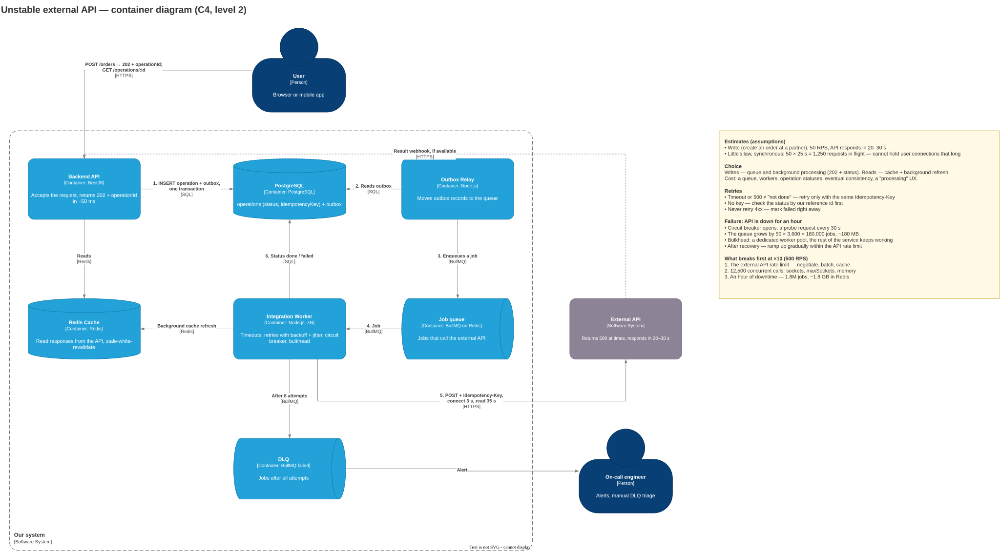
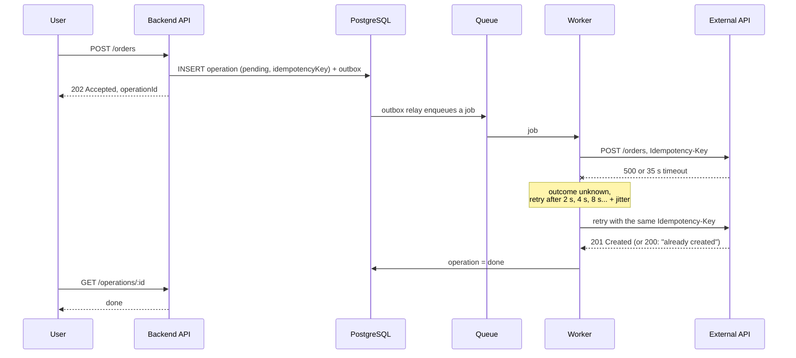

# 2.1.1. Unstable API

> "You need to integrate with an external API that sometimes returns a 500 error and takes 20–30 seconds to respond. How would you design the integration?"

- what the user sees while the API is thinking: a synchronous response or a background job
- which retries are safe and which ones will duplicate the operation
- what happens to your service if the API is down for an hour

## 1. Clarifying questions

| Question | Why it matters |
| --- | --- |
| Read or write? What is the operation: a payment, an order, fetching data? | Decides whether retries are safe |
| Does the user need the result right away, or is "accepted" enough? | Synchronous vs background |
| How many RPS to the API? Does it have a rate limit? | Little's law calculation |
| Does the API support `Idempotency-Key`? Is there a status endpoint or a webhook? | Without it, retrying writes is dangerous |
| What is the API's SLA, how often does it return 500? | How many retries, which timeouts |

**Assumptions:** a write (creating an order at a partner), 50 RPS, 20–30 s response time, `Idempotency-Key` is supported, `GET /orders/{ref}` exists.

## 2. Why synchronous does not work

By Little's law: 50 RPS × 25 s = **1,250 requests in flight**, each one holding a user connection.

- The user waits 30 s, the client gives up on a timeout; load balancers and proxies often drop the connection after 30–60 s.
- The API slows down to 60 s — 3,000 concurrent requests, sockets and memory run out, a cascading failure.

## 3. Options and their cost

- **A. Synchronous call with a timeout and retries.** Pro: simple, the result is immediate. Cost: the connection hangs for up to 30 s, retries make the wait longer, users see every API failure. Works only if the API is normally fast.
- **B. Accept → queue → process in the background.** Pro: ~50 ms response, API failures are isolated, retries are controlled. Cost: a queue, workers, operation statuses, eventual consistency, a "processing" UX.
- **C. For reads: cache + background refresh (stale-while-revalidate).** Pro: the user does not wait for the API. Cost: stale data, a TTL policy.

**Choice:** writes — B, reads — C.

## 4. Container diagram

Source: [containers.drawio](containers.drawio)

## 5. Request and retry flow

## 6. What the user sees while the API is thinking

1. Immediately `202 Accepted` + `operationId`; the UI shows "Order accepted, processing".
2. The result: polling `GET /operations/:id` every 2–5 s (cost — extra requests), WebSocket / SSE (cost — holding connections, pub/sub between instances), or email / push if processing takes minutes.
3. On a final error — a clear "failed" status or manual handling by support. The user never sees a 500.

## 7. Which retries are safe and which ones duplicate the operation

**Key point:** a timeout or a 500 does not mean "not done" — the API may have created the order and failed on the response.

| Situation | Retry? |
| --- | --- |
| `GET`, a read | Yes |
| `PUT` "set the value" | Yes, idempotent by nature |
| `POST` with `Idempotency-Key` | Yes: the API returns the same result instead of creating a second order |
| `POST` **without** a key after a timeout or 500 | **Not blindly.** Check the status by our `reference id` first |
| Connection error (DNS, connection refused) | Yes: the request never arrived |
| `429` / `503` with `Retry-After` | Yes, after the given pause |
| `400`, `401`, `404`, `422` | No: a retry gives the same error. Straight to failed or the DLQ |

**How to retry:** exponential backoff (2 s, 4 s, 8 s… capped at a few minutes) + jitter, a limited number of attempts (for example, 8), then the DLQ and an alert. The idempotency key is generated **once** when the operation is created and stored in the DB.

**API without idempotency:** pass our `client_reference_id` and look the order up by it before retrying. If there is no lookup — reconcile with a report.

**Why the outbox:** without it, the process can crash between the DB write and enqueueing — an operation with no job. The outbox is written in the same transaction, and a relay delivers it to the queue. Cost: one more component and some latency. Simpler alternative: enqueue after commit + a sweeper for stuck `pending` operations.

## 8. What happens if the API is down for an hour

**Without protection:** workers hang for 35 s on each call, retries multiply the load, and after recovery a flood of requests takes the API down again.

**With protection:**

1. **Circuit breaker** opens after, for example, 50% errors within a minute. Workers stop wasting slots; a probe request every 30 s (half-open).
2. **Jobs pile up in the queue:** 50 RPS × 3,600 s = **180,000 jobs**, ~180 MB in Redis at 1 KB per job. Alert on Redis memory; PostgreSQL is the source of truth, so losing Redis does not lose operations.
3. **Bulkhead:** a dedicated worker pool with limited concurrency for this API — the rest of the service keeps working.
4. **Users** see "processing"; reads are served from the cache with stale data.
5. **After recovery** worker throughput is capped by the API rate limit, ramped up gradually. Jobs that no longer make sense have a TTL.
6. **Alerts:** queue length, age of the oldest job, circuit breaker state, DLQ size.

## 9. Timeouts

- Connect timeout — 2–3 s: if the API does not accept the connection, there is nothing to wait for.
- Read timeout — ~35 s: slightly above the API's p99 (30 s), otherwise we abort successful requests.
- A long timeout is fine in a background worker, but not on the user's synchronous path.

## 10. What breaks first at ×10

500 RPS × 25 s = **12,500 concurrent calls** in the workers.

1. **The external API rate limit** — first. This is not solved with code: negotiate limits, batch, cache reads.
2. Sockets and the Node HTTP agent (`maxSockets`), memory for pending requests.
3. The queue during an hour of API downtime: 1.8M jobs, ~1.8 GB in Redis.

**Pitfalls:** retrying a `POST` without an idempotency key; retries without backoff and jitter; a 30 s timeout on the user's synchronous path; no answer to "what does the user see"; a new idempotency key on every retry.
