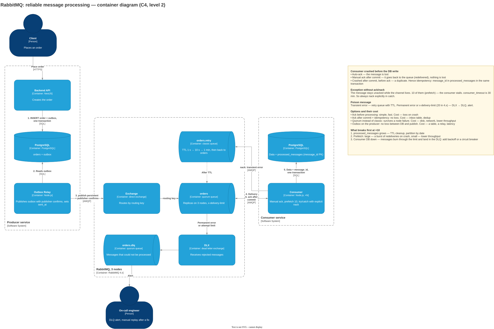

# 2.1.2. RabbitMQ

> "A RabbitMQ consumer received a message and crashed before saving it to the database. What happens, and how do you make the system safer?"

- when the consumer acknowledges the message and what depends on it
- what happens on redelivery and with a message that always fails
- compare with how this is solved in your project on BullMQ and Kafka

## In short

It all depends on when the consumer acknowledges the message (ack).

- **Auto-ack:** RabbitMQ deletes the message as soon as it hands it to the consumer. The consumer crashes — **the message is lost**.
- **Manual ack after the DB commit:** the consumer crashes, the connection drops, RabbitMQ puts the message back in the queue and gives it to another consumer. Nothing is lost, but a **duplicate** is possible: if the crash happened after the commit but before the ack, the message is processed twice.

**How to make it safer:** ack only after commit, an idempotent consumer, a retry limit and a DLX for messages that always fail. On the producer side — a durable quorum queue, persistent messages, publisher confirms and a transactional outbox.

Key point: exactly-once delivery does not exist. What exists is at-least-once + idempotent processing.

## 1. Clarifying questions

| Question | Why it matters |
| --- | --- |
| What is the current ack mode? | `noAck: true` or an ack at the start of the handler is exactly the loss |
| What does the consumer do: write to the DB, charge money, send an email? | Decides the cost of a duplicate |
| "Crashed" — the process died, or an exception was thrown? | These are different scenarios, see section 3 |
| Classic or quorum queue? | Whether the queue survives a RabbitMQ node failure |
| Does message order matter? | Strict ordering limits parallelism |

## 2. Where the failure can happen

| Moment of the crash | Auto-ack | Manual ack after commit |
| --- | --- | --- |
| Received, not yet written to the DB | Lost | The message comes back, all good |
| Written to the DB, no ack yet | OK | Duplicate: the message arrives again |
| After the ack | OK | OK |

The second window cannot be removed: the DB commit and the RabbitMQ ack are two different systems without a shared transaction. So the consumer must handle a repeat calmly.

## 3. A dead process and an exception are different things

**Prefetch** is how many messages RabbitMQ hands to a consumer without acknowledgement. Like a library: you can hold at most 10 books, and you get new ones only after returning the old ones.

- **The process died** (OOM, pod restart). RabbitMQ sees the connection drop and returns all unacknowledged messages to the queue with `redelivered: true`. This is the good scenario.
- **An exception, the process is alive.** Neither ack nor nack was sent. For RabbitMQ the consumer is still processing the message, and it will not come back to the queue. Once 10 of these pile up, the consumer gets nothing new. The service looks alive, but the queue is stuck. After `consumer_timeout` (30 minutes by default) RabbitMQ closes the channel itself.

So the handler always answers the broker explicitly:

```ts
channel.consume('orders', async (msg) => {
  try {
    await handle(msg);       // DB write
    channel.ack(msg);        // only after commit
  } catch (err) {
    channel.nack(msg, false, false); // do not requeue, send to the DLX
  }
});
```

## 4. Idempotent consumer

Processing the same message twice must not change the result:

- **Natural key:** `INSERT ... ON CONFLICT (order_id) DO NOTHING`, `UPDATE ... WHERE status = 'pending'`.
- **Processed messages table (inbox):** `processed_messages(message_id PRIMARY KEY)`. Insert in **the same transaction** as the business write. A duplicate hits the unique constraint — ack without processing again.
- The `message_id` is set by the producer (UUID), not by RabbitMQ.
- Side effects outside the DB (email, external API) — via an `Idempotency-Key`, as in [2.1.1](../2.1.1%20-%20Unstable%20API/README.md).

## 5. A message that always fails (poison message)

`nack` with requeue and no limit is an endless loop: the message fails, comes back, fails again. CPU at 100%, logs flooded.

- **Separate the errors.** Transient (DB unavailable) — retry later. Permanent (invalid JSON) — straight to the DLQ.
- **Limit attempts.** A quorum queue has `x-delivery-limit` (20 by default in RabbitMQ 4.x). After the limit, the message goes to the **DLX** (dead letter exchange) and then to the DLQ.
- **Delayed retry:** a retry queue with a TTL whose DLX points back to the main queue (1 s, 10 s, 1 min).
- An alert on the DLQ and a tool for manual replay after the fix.

## 6. The producer side

A message can be lost before it reaches the consumer, on its way to the queue:

- **The broker restarted.** A queue without `durable` and a message without `persistent` lived only in memory and are gone.
- **A RabbitMQ node died.** A classic queue lives on one node. A **quorum queue** replicates messages to 3 nodes and confirms the write once a majority has stored it. Cost: more disk and network, lower throughput.
- **The message never reached the broker.** `publish()` is fire-and-forget by default. **Publisher confirms**: the broker replies "stored"; no reply — the producer retries.
- **The producer crashed between the DB write and the publish** (dual write). The fix is a **transactional outbox**: the event is written to an `outbox` table in the same transaction as the business data. A separate relay reads `outbox`, publishes with confirms and marks the record as sent. The relay may send an event twice — the idempotent consumer handles it.

## 7. Container diagram



Source: [containers.drawio](containers.drawio)

## 8. Comparison with BullMQ and Kafka

The model is the same everywhere — at-least-once. The mechanism differs.

| | RabbitMQ | BullMQ | Kafka |
| --- | --- | --- | --- |
| Acknowledgement | ack per message | The handler finished without an error | Commit of the partition offset |
| Consumer crashed | Unacknowledged messages go back to the queue | The job lock expires (`lockDuration`, 30 s), the job goes back to the queue | Another consumer takes the partition and reads from the last commit |
| Retries | DIY: delivery limit, TTL + DLX | Built in: `attempts` + `backoff` | None: build retry topics yourself |
| Poison message | DLX | The `failed` set — effectively a DLQ | Blocks the partition, needs a retry topic + DLT |
| How to lose data | `noAck: true` | The job exceeds `maxStalledCount` — moved to `failed` | `enable.auto.commit`: the offset is committed on a timer before processing |

## 9. What breaks first at ×10

- The `processed_messages` table grows — TTL cleanup or partitioning by date.
- Prefetch: large — one crashed consumer returns many messages at once; small — throughput drops.
- The consumer's DB goes down — all messages quickly exhaust the attempt limit and land in the DLQ, even though the error is transient. Add backoff or a circuit breaker in front of the DB.
- Strict ordering: requires a single active consumer (`x-single-active-consumer`) — no parallelism. Better to make the consumer tolerant to ordering (check a version or status).

**Pitfalls:** "RabbitMQ guarantees delivery" without mentioning ack; ack before commit; requeue without a limit; promising exactly-once; forgetting the producer (persistent, confirms, outbox).
