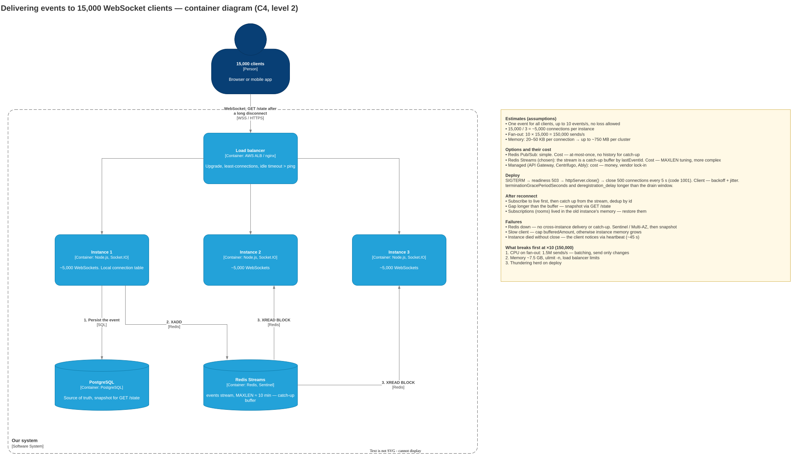

# 2.1.3. WebSocket

> "There are three backend instances and 15,000 WebSocket connections. How do you make sure events are delivered to all clients?"

- an event happened on instance 1, but the client is connected to instance 3 — how does it get there
- what happens to the connections when an instance restarts during a deploy
- what the client gets after reconnecting — and what it loses

## In short

15,000 connections on 3 instances is about 5,000 per instance. That is not much: a single Node process holds tens of thousands of WebSockets. The problem is not the count but that instances do not know about each other's clients.

- **How the event gets there:** through a shared channel between instances (a backplane). Each instance knows only its own sockets, so instance 1 publishes the event, and all three instances receive it and send it to their clients.
- **Deploy:** graceful shutdown. The instance leaves the load balancer and closes connections with code `1001 Going Away` **in batches**, not all 5,000 at once. Clients reconnect to other instances with backoff and jitter.
- **After reconnecting:** events during the gap are lost unless there is a catch-up. Every event has an `id`, the client sends its `lastEventId`, and the server replays what was missed from a buffer (Redis Streams). If the gap is longer than the buffer, the client takes a snapshot via REST.

## 1. Clarifying questions

| Question | Why it matters |
| --- | --- |
| Is the event the same for everyone (a dashboard) or personal (a notification)? | One shared channel or per-user channels |
| Event rate? | Fan-out: 10 events/s × 15,000 = 150,000 sends/s |
| Can events be lost? | Exchange rate — only the latest value matters. Notification — must not be lost |
| Is there a source of truth (DB)? | Where to get the snapshot after a disconnect |

**Assumptions:** events for all clients (order statuses on a dashboard), up to 10 events/s, no loss allowed, a few seconds of delay after reconnect is acceptable.

## 2. Options and their cost

- **A. Redis Pub/Sub + `@socket.io/redis-adapter`.** Simple, ready-made. Cost: at-most-once, no history for catch-up.
- **B. Redis Streams (or Kafka) as the backplane.** Each instance reads the stream from its own position, and the stream itself is the buffer for catch-up by `lastEventId`. Cost: managing the stream size (`MAXLEN`), more complex. In Socket.IO — `@socket.io/redis-streams-adapter` + Connection State Recovery.
- **C. A managed service** (AWS API Gateway WebSocket, Centrifugo, Ably, Pusher). Connections and fan-out are handled outside our code. Cost: money, vendor lock-in, an external dependency.

**Choice:** B. No loss allowed — a catch-up buffer is needed. 15,000 connections do not justify a managed service. If loss were acceptable (only the latest value matters), A would be enough.

## 3. Container diagram



Source: [containers.drawio](containers.drawio)

## 4. How an event gets from instance 1 to a client on instance 3

1. The event happens on instance 1 and is saved to the DB.
2. Instance 1 writes it to the Redis Stream: `XADD events * ...`.
3. All three instances read the stream (`XREAD BLOCK`) and send the event to their clients from the local connection table.
4. The event is serialized **once**, not per client — CPU savings on 5,000 sends.

## 5. Deploy

**Without preparation:** the pod is killed, 5,000 clients reconnect to the two remaining instances at once and request a catch-up. That is a thundering herd — a load spike on the instances, Redis and the DB.

**The right way:**

1. `SIGTERM` → the readiness probe returns 503, pause a few seconds until the load balancer removes the pod from rotation. Otherwise clients reconnect back to the dying instance.
2. `httpServer.close()` — no new connections are accepted, existing ones stay alive.
3. Close existing connections in batches: 500 connections every 5 s, 10 batches — about 50 s.
4. The client reconnects with exponential backoff + jitter: within a batch, 500 clients get the close at the same moment.
5. Rolling update with `maxSurge`: the new pod starts before the old one is killed.

```ts
process.on('SIGTERM', async () => {
  ready = false;            // /ready → 503
  await sleep(5000);        // the load balancer removes the pod from rotation
  httpServer.close();       // stop accepting new connections

  const clients = [...wss.clients];
  for (let i = 0; i < clients.length; i += 500) {
    for (const ws of clients.slice(i, i + 500)) ws.close(1001, 'server restarting');
    await sleep(5000);
  }
  process.exit(0);
});
```

**Time limits.** Kubernetes `terminationGracePeriodSeconds` (30 s by default) and AWS ALB `deregistration_delay` (300 s by default) must be longer than the drain window. Otherwise the remaining connections are cut all at once.

**Alternative:** the server sends everyone `{ type: 'reconnect', withinMs: 30000 }` at once, and each client reconnects after a random delay. This needs client support, so server-side batched drain stays as a fallback.

**Non-obvious:** after a rolling update the load is uneven — the first clients to reconnect settled on old instances, and the last new instance is almost empty. The load balancer only distributes new connections. Least-connections and a soft reconnect for some clients help.

**Crash** (OOM): no close frame arrives, the client notices the disconnect only via heartbeat. In Socket.IO that is `pingInterval` + `pingTimeout`, about 45 s by default.

## 6. What the client gets after reconnecting and what it loses

**Gets:**

- new events — right away;
- missed events — if `lastEventId` is still in the stream buffer (for example, the last 10 minutes);
- a snapshot via `GET /state` — if the gap is longer than the buffer.

**Loses, unless handled:**

- events during the gap, if the backplane is Pub/Sub without a buffer;
- subscriptions (rooms): they lived in the old instance's memory, so the client subscribes again. Socket.IO Connection State Recovery restores them automatically, but only within `maxDisconnectionDuration`;
- events the server sent but the client never received: `ws.send()` does not confirm delivery. The same `lastEventId` covers this.

Order on reconnect: subscribe to live first, then catch up, and drop duplicates by `id`.

## 7. What happens on failure

- **Redis is down:** events do not flow between instances, catch-up does not work. Sentinel or managed Multi-AZ. After recovery, clients take a snapshot.
- **Slow client** (poor mobile network): the socket buffer (`ws.bufferedAmount`) grows, and so does instance memory. Over the limit — disconnect; the client reconnects and takes a snapshot. Without a limit, one such client can take an instance down on memory.

## 8. What breaks first at ×10 (150,000 connections)

1. **Fan-out:** 10 events/s × 150,000 = 1.5M sends/s — CPU breaks first. More instances, batching (one send every 100 ms), send only changes.
2. **Memory:** 20–50 KB per connection, 150,000 × 50 KB ≈ 7.5 GB per cluster.
3. **OS and load balancer limits:** `ulimit -n` (file descriptors), the load balancer's connection limit.
4. **Deploy:** the thundering herd is 10× stronger — batched drain and jitter are mandatory.
5. **Personal events:** per-user channels and sharded pub/sub are needed (Redis 7: `SPUBLISH` / `SSUBSCRIBE`).

**Pitfalls:** answering only "sticky sessions"; killing an instance on deploy without a drain; promising nothing is lost after reconnect without a catch-up mechanism; forgetting subscriptions held in the old instance's memory; not calculating fan-out.
