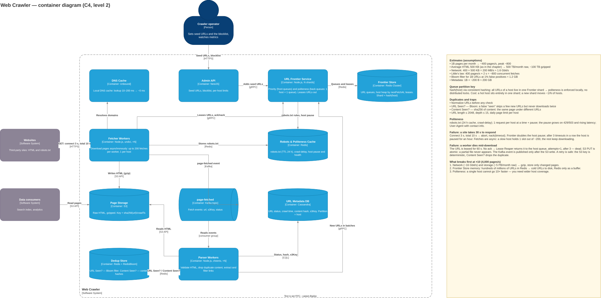

# 2.2. Web Crawler

> A task from the ByteByteGo course — chapter [Design A Web Crawler](https://bytebytego.com/courses/system-design-interview/design-a-web-crawler).

- how not to download the same page twice and not get stuck on infinite URLs
- how not to take down someone else's site with your requests
- how to split the URL queue between workers and by which key
- how many pages per second you download and how much storage they take per month — with assumptions
- what breaks first at ×10 pages

## In short

A crawler is a pipeline of three steps: **URL queue (Frontier) → download (Fetcher) → parse (Parser)**, and the parser puts the links it finds back into the queue.

- **Volume:** 1B pages per month — about 400 pages/s, about 500 TB of raw HTML per month (~100 TB gzipped).
- **The URL queue** is sharded by `hash(host)`: all URLs of a site live in one shard. Politeness (at most one request to a host at a time + a pause) is enforced locally, without distributed locks.
- **Duplicates:** URL normalization, a Bloom filter for "this URL was already seen", a content hash for "this page was already seen under a different URL". Traps are cut off by limits on URL length, depth and pages per host.
- **Failures:** a URL is leased to a worker for 60 s. The worker dies — the lease expires, the URL goes back to the queue. A slow site is cut off by a 10 s timeout, and the pause for that host grows.

## 1. Clarifying questions

| Question | Why it matters |
| --- | --- |
| What is the crawler for: a search index, price monitoring, an archive? | What to store and how often to recrawl |
| How many pages per month? | Number of workers, network, storage |
| HTML only, or PDFs and images too? | Page size and parsers |
| How often to recrawl pages? | Recrawling is the main load after the first pass |
| How long to keep downloaded content? | Storage grows linearly |
| Do we respect robots.txt? | Yes by default — politeness and legal risk |

**Assumptions:** a search index, 1B pages per month, HTML only, keep for 5 years, respect robots.txt.

## 2. Volume estimates

| What | Calculation | Result |
| --- | --- | --- |
| Throughput | 1B / (30 × 86,400 s) | ~400 pages/s, peak ~800 |
| Storage | 1B × 500 KB (average page, as in the chapter) | 500 TB/month raw, ~100 TB gzipped |
| Storage over 5 years | 100 TB × 60 months | ~6 PB gzipped |
| Network | 400 × 500 KB | 200 MB/s ≈ 1.6 Gbit/s |
| Concurrent fetches (Little's law) | 400 pages/s × 2 s per page | ~800 |
| URL Bloom filter | 1B URLs, 1% false positives | ~1.2 GB |
| URL metadata | 1B × ~200 B | ~200 GB |

## 3. Options and their cost

**URL queue partition key:**

- `hash(url)` — even distribution. Cost: URLs of one site are spread over all shards, politeness needs a distributed per-host lock.
- **`hash(host)` via consistent hashing (chosen).** Politeness is enforced inside the shard. Cost: a hot host sits entirely in one shard; a new shard moves ~1/N of hosts.

**"URL already seen" check:**

- An exact set (URL hashes in Redis or a DB). No errors. Cost: tens of GB of memory for 1B URLs.
- **Bloom filter (chosen).** ~1.2 GB. Cost: ~1% false "seen" — we skip a few new URLs, but never download a page twice.

**Queue storage:**

- Kafka. Reliable, scales. Cost: you cannot pick "the next URL of a host whose pause has expired" — unsuitable for politeness.
- **Redis Cluster with one queue per host and a host heap by `nextFetchAt` (chosen).** Flexible scheduling. Cost: everything is in memory — as it grows, cold URLs must move to disk.

**URL metadata:**

- PostgreSQL. Familiar. Cost: 1B rows and constant writes — writes become the bottleneck, sharding is needed.
- **Cassandra, partition = host (chosen).** Horizontally scalable writes. Cost: no JOINs or transactions, eventual consistency.

**Downloading:** asynchronous (up to 200 fetches per worker, but at most one per host), not a thread per page. 800 concurrent fetches is 4 workers, 8 with headroom. Cost: watching memory and sockets.

## 4. Container diagram

Source: [containers.drawio](containers.drawio)

Components (C4, level 3) — source [components.drawio](components.drawio):

- [URL Frontier Service](components-1.svg) — priority and politeness
- [Fetcher Worker](components-2.svg) — downloading
- [Parser Worker](components-3.svg) — parsing and deduplication

## 5. How not to download twice or loop forever

- **URL normalization** before any check: lowercase host, no `#fragment` or `utm_*`, sorted query. One page — one URL.
- **URL Seen?** — Bloom filter (`BF.EXISTS` / `BF.ADD`): "no" is exact, "yes" is wrong ~1% of the time.
- **Content Seen?** — sha256 of the content: the same page under different URLs (~30% of web pages are duplicates) stops here.
- **Traps (infinite URLs):** URL length ≤ 2048, depth ≤ 15, at most 10,000 pages per host per day, repeated path segments (`/a/b/a/b/`).

## 6. How not to take down someone else's site

- robots.txt cached for 24 h; respect `Disallow` and `crawl-delay`.
- One queue per host: at most one request to a host at a time + a pause.
- The pause grows on `429` / `503`, timeouts and rising latency.
- A `User-Agent` with the crawler owner's contact.

## 7. How to split the queue between workers

- **Front queues** — by priority (importance signal, update frequency, depth). The queue is picked by weighted random: higher priority — more often.
- **Back queues** — by host: one queue = one host. A host heap by `nextFetchAt` hands out only hosts whose pause has ended.
- The Frontier is sharded by `hash(host)`. Workers lease URLs in batches for 60 s and reply with ack / nack.

## 8. What happens on failure

**A site takes 30 s to respond.** Connect timeout 3 s, total 10 s — abort, `nack(timeout)`. The Frontier doubles the host pause; after 3 timeouts in a row the host is paused for an hour. Fetches are asynchronous: a slow host holds 1 slot out of ~200, the rest keep downloading.

**A worker dies mid-download.** No ack — after 60 s the Lease Reaper returns the URL to the host queue, `attempts + 1`, after 3 attempts — dead. S3 PUT is atomic: a partially downloaded file never appears. The Kafka event is published only after the S3 write. A retry is safe: the S3 key is deterministic (`sha256(url)/crawlTs`), and Content Seen? drops the duplicate.

**The parser crashed.** The Kafka offset is committed after processing — the event comes again, and deduplication makes the retry safe.

## 9. What breaks first at ×10 (4,000 pages/s)

1. **Network and storage:** ~16 Gbit/s and ~5 PB raw per month. gzip, store only changed pages.
2. **Frontier Store memory:** hundreds of millions of URLs in Redis. Cold URLs go to disk, Redis is only a buffer.
3. **Politeness:** a single host cannot be downloaded 10× faster — you need wider host coverage.

**Pitfalls:** sharding the queue by URL and losing politeness; an exact URL set in memory without doing the math; no limits on depth and URL length; synchronous downloading with a thread per page; estimates without assumptions.
