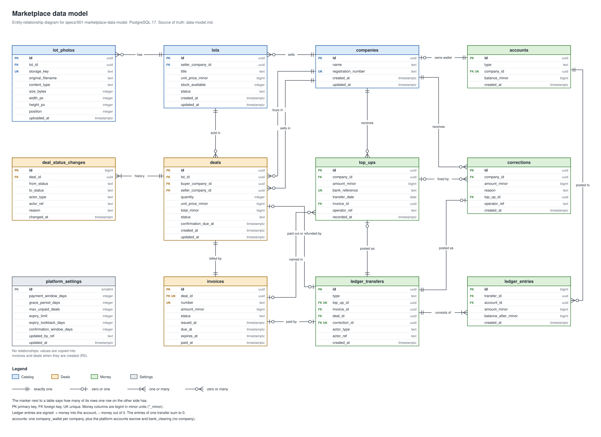
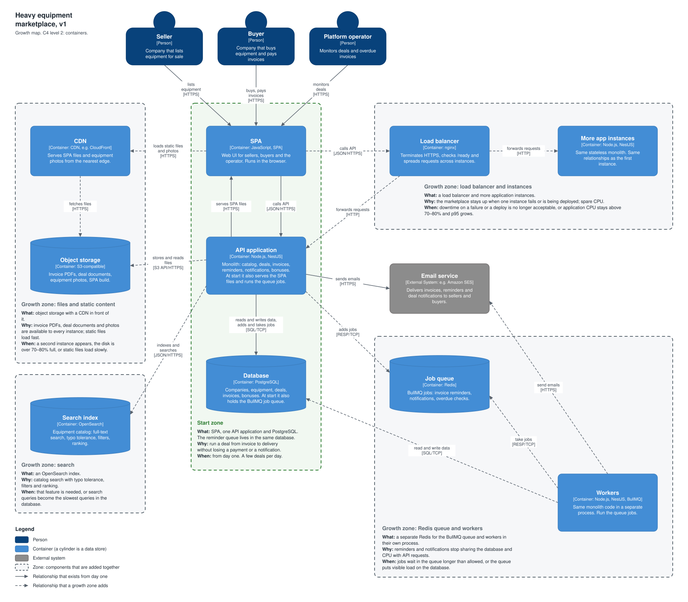

# Marketplace v2: heavy equipment marketplace

System design case, version 2. It describes the target system and how it grows. Version 2 keeps everything from [version 1](../marketplace-v1/README.md) and moves every settlement between buyer and seller inside the platform: company wallets, invoices paid into escrow, and a ledger. The diagrams of what this repository runs today are separate.

## What changed since v1

- Companies hold money in wallets inside the platform. All settlements between a buyer and a seller go through those wallets.
- The platform still does not accept or pay out money. External systems do. When a bank notification about a transfer arrives, the operator records a top-up: whose wallet, how much, the bank reference.
- A purchase reserves the units and issues an invoice with a due date. The buyer pays the invoice from the wallet into escrow. The seller gets the money after the buyer confirms delivery, or after the confirmation window ends without a claim.
- Limits stop a buyer from blocking stock with invoices that are never paid.
- The data model is designed: tables, relationships and money rules. See [Data model](#data-model).
- v1 assumed that buyers pay sellers by bank transfer outside the platform. That assumption is replaced; the rest of v1 holds.

## Case

- Sellers are companies that list equipment worth millions of dollars. Buyers are companies too. The platform operator monitors the deals.
- There are few deals, a few per day. Each one is expensive, so a lost payment or a lost notification costs a lot.
- The buyer gets an invoice and pays it by the due date. Reminders go out 2 days before, 1 day before and on the due date. An unpaid invoice becomes overdue, and both sides are notified.
- Both sides get notifications as the deal moves: money sent, money received, goods shipped, goods delivered.
- The buyer earns bonuses for paying on time.
- New in v2: each company has a wallet. Lots have a title, a price and a stock; the seller publishes a lot and can hide it. Lot photos are files in object storage with their metadata in the database.
- New in v2: a deal records who bought what, from whom, how many units and at what price. A money journal records who was topped up, when and by how much, and every debit and credit.

Decisions that are already made:

- The marketplace is a monolith. Microservices are out of scope for now.
- The frontend is a SPA and the backend is a pure API. The API returns JSON and serves any client: browsers, mobile and desktop applications, partners. The frontend and the backend are developed separately.
- Later, partners and agents get access through the same API, for example through MCP.
- HTML pages, if they are ever needed, are a template engine on top of the same content.

## Data model

The full model is in the feature specification [`specs/001-marketplace-data-model/`](../../../specs/001-marketplace-data-model/): the [spec](../../../specs/001-marketplace-data-model/spec.md), the [design decisions](../../../specs/001-marketplace-data-model/research.md) and the [tables with every rule](../../../specs/001-marketplace-data-model/data-model.md). This section is the summary.

`erd.drawio.svg` is both the picture and the source. Open it in [draw.io](https://app.diagrams.net/) to edit it. It is a copy of the file in the feature folder; keep the two identical.

How a deal moves:

| Step                                                                              | Deal status        | Money                   | Stock                   |
| --------------------------------------------------------------------------------- | ------------------ | ----------------------- | ----------------------- |
| Buyer purchases; an invoice is issued with a due date                             | awaiting payment   | none                    | reserved                |
| Invoice paid from the buyer's wallet (by hand, or at once when a top-up names it) | paid               | buyer wallet to escrow  | stays reserved          |
| Seller ships                                                                      | shipped            | none                    | sold                    |
| Buyer confirms delivery, or the confirmation window ends                          | completed          | escrow to seller wallet | sold                    |
| Buyer cancels, or the invoice expires unpaid                                      | cancelled, expired | none                    | returned                |
| Seller cancels a paid deal, or the operator refunds after a claim                 | refunded           | escrow to buyer wallet  | returned if not shipped |

Money rules:

- Money is a double-entry ledger. Every movement is a transfer whose entries sum to 0. Besides the company wallets there are two platform accounts: escrow, and bank clearing (the counterpart of every top-up). The sum of all balances is always 0.
- A company wallet never goes below 0. The ledger is append-only: a mistake is fixed with a correction that records the reason.
- Amounts are exact integers in minor units (cents). One currency.

Abuse protection (platform settings that the operator can change):

- An invoice is due in 5 days, with 1 more day of grace before it expires and the units go back to the lot.
- A buyer can have at most 3 unpaid deals at a time.
- A buyer with 2 expired deals in 30 days can only buy with immediate payment.

Not modelled yet: users and permissions (a separate security feature), sending notifications and reminders, calculating bonuses. The deal statuses and invoice dates are their inputs.

## Growth map

One C4 container diagram, split into zones. A zone is a dashed frame around the components that are added together. Each zone says what is added, why the marketplace needs it, and when: the signal that makes us consider it.

The growth map is unchanged from v1: wallets, invoices and escrow are tables in the same PostgreSQL database, not new containers.

The file lives in the v1 folder. It is both the picture and the source: open it in [draw.io](https://app.diagrams.net/) to edit it.

How to read it:

- The **Start zone** is the minimum the marketplace launches with. A solid arrow is a relationship that exists from day one.
- A **growth zone** is added only when its signal appears. A dashed arrow is a relationship that the zone adds. The zones are independent: they have no fixed order.
- A component is not always new infrastructure. At start the reminder queue lives in PostgreSQL ([BullMQ runs on PostgreSQL](https://docs.bullmq.io/guide/postgresql)), and the API application runs the jobs itself. The "Redis queue and workers" zone moves the same queue to its own Redis and its own processes.

Assumptions that the case does not state:

- Notifications are sent by email through an external email service. It delivers them to sellers and buyers; those arrows are left out to keep the map readable.
- The marketplace keeps money in company wallets and an escrow account, and settles every deal inside the platform. Money enters only when the operator records a top-up from a bank notification. Money leaves the platform outside this system: there are no payouts to bank accounts. A bank or payment provider integration is not on the map.
- Partners and agents are not on the map. They are a future client of the same API, like the SPA.
- Monitoring is not on the map, to keep it to four growth zones. The signals below need metrics and logs from day one.

## Components

Only the components that are on the map.

| Component                        | Zone                        | Why the marketplace needs it                                                                                                    | When it is needed, and when it is not                                                                                                                                                                                                                                  | How it scales                                                                                                                         | In the cloud (AWS)                                                                                                                                                                         |
| -------------------------------- | --------------------------- | ------------------------------------------------------------------------------------------------------------------------------- | ---------------------------------------------------------------------------------------------------------------------------------------------------------------------------------------------------------------------------------------------------------------------- | ------------------------------------------------------------------------------------------------------------------------------------- | ------------------------------------------------------------------------------------------------------------------------------------------------------------------------------------------ |
| SPA                              | Start                       | The web UI for sellers, buyers and the operator. It is built and released separately from the backend.                          | Needed from day one. Not needed for partners and agents: they call the API directly.                                                                                                                                                                                   | It is a set of static files with no server state. The API application serves them at start, and a CDN serves them later.              | S3 with CloudFront. No server to run for static files; HTTPS and caching are included.                                                                                                     |
| API application                  | Start                       | All business logic in one deployable unit: catalog, deals, invoices, wallets and the ledger, reminders, notifications, bonuses. | Always needed. One instance is enough for a few deals per day.                                                                                                                                                                                                         | It keeps no state, so it scales out: more instances behind a load balancer. A bigger server is the simpler first step.                | ECS on Fargate. It runs the container without a server to patch, restarts a failed task and does rolling deploys. On a VPS you write that yourself.                                        |
| Database (PostgreSQL)            | Start                       | The source of truth for deals and money. Transactions keep an invoice, its payment and the bonus consistent.                    | Always needed.                                                                                                                                                                                                                                                         | First indexes and query fixes, then a bigger server, then a read replica. Partitioning and sharding come last.                        | RDS for PostgreSQL. Automated backups with point-in-time recovery, failover to a standby in another zone (Multi-AZ) and patching. On a VPS all three are your scripts and your night call. |
| Job queue in PostgreSQL (BullMQ) | Start                       | Invoice reminders, the overdue check and notifications run as jobs with retries, so a restart does not lose them.               | Needed from day one, because a lost reminder is expensive. A separate queue server is not needed while there are few jobs.                                                                                                                                             | It shares the database with the main work. The next step is the "Redis queue and workers" zone.                                       | No separate service: the jobs live in RDS, and the same backups cover them.                                                                                                                |
| Load balancer                    | Load balancer and instances | One entry point. It checks `/ready` and stops sending traffic to an instance that failed or is shutting down.                   | Needed with the second instance. Not needed with one instance: it only adds a hop.                                                                                                                                                                                     | A managed balancer scales by itself. Self-hosted nginx needs a second node and a floating IP to stop being a single point of failure. | Application Load Balancer. It runs in several zones, does health checks, and takes TLS certificates from ACM.                                                                              |
| More app instances               | Load balancer and instances | The marketplace stays up when one instance fails or is being deployed. They also add CPU.                                       | Needed when downtime is no longer acceptable, or when CPU is the limit. Not a fix when the database is the limit: more instances open more connections and make it worse.                                                                                              | Add instances. Keep instances × connection pool size under the database connection limit.                                             | The desired task count of the ECS service, with auto scaling on CPU. On a VPS you add servers and edit the balancer configuration by hand.                                                 |
| Object storage                   | Files and static content    | Invoice PDFs, deal documents and equipment photos, available to every instance.                                                 | Needed with the second instance, because each instance has its own local disk, or when the disk fills up. Not needed while one instance keeps a few files on a backed-up disk.                                                                                         | Capacity is not planned: it grows with the data.                                                                                      | S3. Designed for 99.999999999% durability, with versioning and lifecycle rules. On a VPS you run MinIO or RustFS and own the disks and the replication.                                    |
| CDN                              | Files and static content    | Serves the SPA and the photos from a node near the user, and takes that traffic off the application.                            | Needed when users are far from the server, or static files are a visible part of the application load. Not needed while all customers are in one region.                                                                                                               | The provider's edge network scales it.                                                                                                | CloudFront. An edge network around the world, with HTTPS and caching rules. On a VPS you would rent and run servers in every region.                                                       |
| Job queue (Redis)                | Redis queue and workers     | A dedicated store for the BullMQ queue, so jobs stop competing with deals for the database.                                     | Needed when the queue puts visible load on the database. Not needed for a few deals per day. It has a cost: Redis must run with persistence (AOF) and the `noeviction` policy, or jobs can be lost.                                                                    | Mostly up: more memory. Add a replica for failover.                                                                                   | ElastiCache (Redis OSS or Valkey). Failover to a replica in another zone and patching are managed. On a VPS you set up replication and failover yourself.                                  |
| Workers                          | Redis queue and workers     | Run the jobs outside the API process, so a heavy job does not slow HTTP requests.                                               | Needed when jobs compete with requests for CPU or the event loop. Not needed at start: the API process runs the jobs.                                                                                                                                                  | Add worker processes or raise the concurrency of each one.                                                                            | A second ECS service from the same image, scaled on the queue length. On a VPS it is one more process that you start, watch and restart yourself.                                          |
| Search index (OpenSearch)        | Search                      | Catalog search with typo tolerance, filters and ranking.                                                                        | Needed when that feature is required, or search queries are the slowest in the database. Not needed for a small catalog: PostgreSQL full-text search and indexes are enough. It is a copy of the data that must be kept in sync; PostgreSQL stays the source of truth. | Shards and replicas on more nodes.                                                                                                    | Amazon OpenSearch Service. Node replacement, snapshots and version upgrades are managed. On a VPS you run and upgrade the cluster yourself.                                                |
| Email service (external system)  | Outside the zones           | Delivers invoices, reminders and deal notifications.                                                                            | Needed from day one. Running our own mail server is not worth it: deliverability is the provider's main job.                                                                                                                                                           | The provider scales it. Our side scales through the job queue and its retries.                                                        | Amazon SES. It handles the sender reputation, bounces and complaints. A self-hosted mail server lands in spam until its IP address earns a reputation.                                     |

### Beyond the map: MongoDB, ClickHouse, Kafka

- **Document database (MongoDB)** is not needed yet, because the deal data is relational: companies, deals, invoices, payments and bonuses reference each other and change together in one transaction. Equipment attributes that differ by type fit a JSONB column in PostgreSQL. Reconsider it in the "huge catalog" scenario.
- **Columnar database (ClickHouse)** is not needed yet, because a few deals per day produce very little data. PostgreSQL answers every operator report. Reconsider it in the "analytics" scenario.
- **Message broker (Kafka)** is not needed yet, because one monolith is the only producer and the only consumer. BullMQ already gives background jobs with retries, and a Kafka cluster is one more system to run. Reconsider it when several independent consumers must read the same stream of events, or replay it.

## Growth signals: what to watch

It is hard to calculate in advance how many requests the system can take. It is more useful to know which metric shows that a component hit its limit, and what to do then. One row per limit, for the components of the Start zone.

| Component                 | What it hits              | Signal: which metric                                                                                                      | What we do                                                                                                                                                              |
| ------------------------- | ------------------------- | ------------------------------------------------------------------------------------------------------------------------- | ----------------------------------------------------------------------------------------------------------------------------------------------------------------------- |
| API application           | CPU                       | CPU of all instances stays above 70–80% for a long time, and p95 grows with it.                                           | More instances behind the load balancer.                                                                                                                                |
| API application           | Event loop                | Event loop lag grows and one core is at 100%, while total CPU still looks fine.                                           | Find the heavy synchronous code. Move it to a job that the workers run.                                                                                                 |
| API application           | Memory under load         | Memory grows together with the request rate and falls back when the load falls.                                           | More memory per instance, or more instances.                                                                                                                            |
| API application           | Memory leak               | Memory grows while the load is flat and does not fall after garbage collection. The instance restarts with out-of-memory. | It is a leak, not load. Take heap snapshots and fix the code. More instances do not help.                                                                               |
| API application           | Waiting for a dependency  | p95 grows, but application CPU is free.                                                                                   | Look below the application: slow queries, waiting for a database connection, locks, the email service. More instances do not help; they open more database connections. |
| Database                  | Slow queries              | A few queries dominate the slow query log. Their plans show sequential scans.                                             | Add an index or rewrite the query. If it is catalog search that an index cannot fix, add the search index.                                                              |
| Database                  | CPU and memory            | CPU stays above 70–80% after the queries are tuned. The cache hit ratio falls and disk reads grow.                        | Scale up: more CPU and memory.                                                                                                                                          |
| Database                  | Read load                 | Most of the load is SELECT, and the server is already big.                                                                | A read replica for the catalog and reports. Money is still read from the primary, because a replica lags.                                                               |
| Database                  | Connections               | The connection count is close to `max_connections`. Requests wait for a free connection in the pool.                      | A smaller pool per instance, or a connection pooler such as PgBouncer.                                                                                                  |
| Database                  | Disk                      | The disk is over 70–80% full. Growth per month shows when it runs out.                                                    | A bigger disk. Archive or partition old data.                                                                                                                           |
| Database                  | Write load and data size  | Writes saturate the primary after it is scaled up, or the data no longer fits one server.                                 | Partitioning first. Sharding is the last step, because a transaction across shards becomes hard. This marketplace is far from it.                                       |
| Files on the server disk  | Disk, and one server only | The disk is over 70–80% full. Or a second instance appears and cannot see the files of the first.                         | Move the files to object storage.                                                                                                                                       |
| Job queue in the database | Throughput                | The age of the oldest waiting job grows. The queue length grows and does not return to zero. Failed jobs appear.          | More concurrency in the application, then separate workers, then a separate Redis for the queue.                                                                        |
| SPA served by the app     | Network distance          | Static files load slowly for users far from the server. Static requests are a visible share of the application load.      | Put the SPA build in object storage behind a CDN.                                                                                                                       |

## Growth scenarios

The business changes. Each scenario lists the components it needs and the task each one solves.

**Real time: we launch an auction.** Every participant sees a bid at once, and the auction closes to the second.

- WebSocket connections in the API application → push each new bid to all participants, with no polling.
- Redis Pub/Sub → delivers a bid to the participants connected to other instances.
- A PostgreSQL transaction with a row lock on the lot → accepts bids in a strict order, so there is one winner.
- Closing time checked on the server for every bid, by the database clock → a late bid is rejected even when the client clock is wrong.
- A delayed job in the queue → announces the result at closing time. The job can fire late, so it only announces; the check above decides.

**Huge catalog: millions of items, from paper clips to heavy machinery.**

- Search index (OpenSearch, several shards) → search and filters over millions of items.
- Cache (Redis) → popular item pages and category lists without a database query.
- Read replicas → catalog reads leave the primary to deals and money.
- JSONB columns, or a document database → a paper clip and an excavator have different attributes.
- Queue and workers → bulk import of seller price lists, and reindexing.

**Whole world: we sell worldwide and it must be fast everywhere.**

- CDN → the SPA and the photos come from a node near the user.
- DNS with latency-based routing → sends the user to the nearest region.
- Application instances with a load balancer in several regions → a short network path for API calls.
- Read replicas in the regions, with writes in one primary region → fast reads everywhere, and money stays consistent in one place.

**Analytics: we collect a lot of user behavior data** (views, searches, abandoned carts).

- Event broker (Kafka) → takes the stream of events without loading the main database, and lets several consumers read it.
- Object storage → keeps the raw events cheaply for years.
- Columnar database (ClickHouse) → aggregates over billions of events in seconds.
- Workers → build the aggregates on a schedule.
- BI dashboard → shows the reports to the business.

**Own scenario: partners and agents work through the API and MCP.** The case plans this. An agent retries and calls much more often than a person does.

- Rate limiter with counters in Redis → one partner cannot use up the capacity of the others.
- API keys or OAuth 2.0 client credentials → identify each partner and limit what it can do.
- Idempotency keys stored in PostgreSQL → a retried request does not create a second invoice or a second payment.
- Webhooks sent through the job queue → partners learn about deal events, with retries when their side is down.
- MCP server as a thin layer over the same API → agents call the same operations as tools.

## References

- [BullMQ: PostgreSQL backend](https://docs.bullmq.io/guide/postgresql)
- [How to Ace System Design Interviews Like a Boss](https://bytebytego.com/guides/how-to-ace-system-design-interviews-like-a-boss/) (ByteByteGo)
- [Cloud Database Cheat Sheet](https://bytebytego.com/guides/cloud-database-cheat-sheet/) (ByteByteGo)
