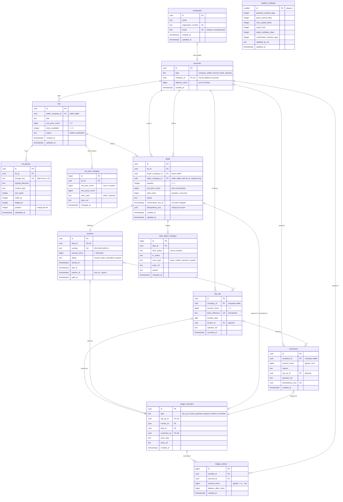
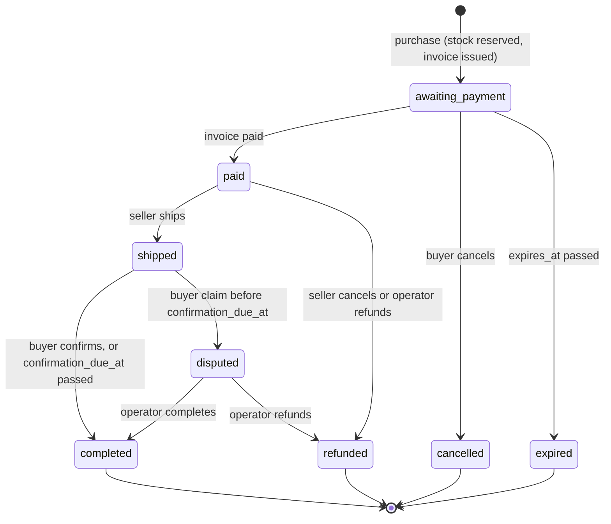

# Data Model: Marketplace

PostgreSQL schema for [spec.md](./spec.md). Design decisions and their alternatives are in [research.md](./research.md) (R1–R13). Feature 002 built this schema and changed it in a few places: a company email, zero or one wallet per company, idempotency keys and lot price history (see the Clarifications of [feature 002](../002-marketplace-schema/spec.md)). Table and column names are `snake_case`; tables are plural.

Conventions for every table:

- Money is `bigint` in minor units, named `*_minor` (R7).
- Times are `timestamptz`. `created_at` defaults to `now()`.
- Status and type columns are `text` with a `CHECK` list (R8).
- `actor_ref` and `operator_ref` are opaque `text` references; the security feature will link them to users.

## Entity-relationship diagram



Cardinality markers: the marker next to a table says how many rows of that table one row on the other side has. For example, `top_ups |o--|| ledger_transfers` reads: a transfer has zero or one top-up (only `top_up` transfers have one), and a top-up has exactly one transfer. `companies |o--o| accounts` reads: a platform account has no company, and a company has zero or one wallet. Lots, deals, top-ups and corrections point to the wallet (`accounts.company_id`), not to the company, so a company needs its wallet before it sells, buys or receives money.

`platform_settings` has no relationships: its values are copied into `invoices` and `deals` when they are created (R5).

How to read the money part: a company's money lives in its `accounts` row. Every change of a balance is one `ledger_transfers` row with two or more `ledger_entries`. A transfer points to the business record that caused it: a top-up, an invoice, a deal or a correction.

## Lifecycles

### Deal



The shipping time is the `changed_at` of the status change to `shipped`; `deals` stores only the deadline it starts. A purchase paid at once is still recorded as two status changes, `awaiting_payment` and then `paid`, in the same transaction. The invoice exists in both cases.

### Invoice

| Invoice status | Set when the deal moves to    |
| -------------- | ----------------------------- |
| `issued`       | `awaiting_payment` (purchase) |
| `paid`         | `paid`                        |
| `cancelled`    | `cancelled`                   |
| `expired`      | `expired`                     |

A paid invoice stays `paid` when the deal is later refunded; the refund is a transfer on the deal.

## Tables

### companies

| Column                | Type        | Rules                                                                     |
| --------------------- | ----------- | ------------------------------------------------------------------------- |
| `id`                  | uuid        | PK                                                                        |
| `name`                | text        | not null, 1–300 chars                                                     |
| `registration_number` | text        | not null, `UNIQUE`                                                        |
| `email`               | text        | not null, at most 254 chars, one `@`, no spaces; unique on `lower(email)` |
| `created_at`          | timestamptz | not null                                                                  |
| `updated_at`          | timestamptz | not null                                                                  |

`registration_number` (the legal registration id) is not in the spec. It is added so the same legal entity cannot be registered twice; drop it if onboarding defines identity differently.

`email` is the company's contact address for billing and notifications, not a login (feature 002). It is stored as typed; the unique index on `lower(email)` makes `Sales@Acme.com` and `sales@acme.com` the same address.

### accounts

| Column          | Type        | Rules                                                                                          |
| --------------- | ----------- | ---------------------------------------------------------------------------------------------- |
| `id`            | uuid        | PK                                                                                             |
| `type`          | text        | `company_wallet`, `escrow`, `bank_clearing`                                                    |
| `company_id`    | uuid        | FK `companies` `ON DELETE RESTRICT`, `UNIQUE`; not null exactly when `type = 'company_wallet'` |
| `balance_minor` | bigint      | not null, default 0                                                                            |
| `created_at`    | timestamptz | not null                                                                                       |

Constraints:

- `CHECK ((type = 'company_wallet') = (company_id IS NOT NULL))`
- `CHECK (type = 'bank_clearing' OR balance_minor >= 0)` and `CHECK (type <> 'bank_clearing' OR balance_minor <= 0)` (R2)
- `UNIQUE (type) WHERE type <> 'company_wallet'`: one escrow and one bank clearing account. Both are created by the migration that creates the table.
- A company has zero or one wallet (FR-002, changed by feature 002). The wallet is a separate activation step; `lots`, `deals`, `top_ups` and `corrections` reference `accounts (company_id)`, so they need it.
- Rows are never deleted, and `type` and `company_id` never change; only the balance changes (trigger `accounts_identity_immutable`).

### lots

| Column              | Type        | Rules                                                     |
| ------------------- | ----------- | --------------------------------------------------------- |
| `id`                | uuid        | PK                                                        |
| `seller_company_id` | uuid        | not null, FK `accounts (company_id)`: the seller's wallet |
| `title`             | text        | not null, 1–200 chars                                     |
| `unit_price_minor`  | bigint      | not null, `> 0`                                           |
| `stock_available`   | integer     | not null, `>= 0`; reserved units are already subtracted   |
| `status`            | text        | `hidden`, `published`; default `hidden`                   |
| `created_at`        | timestamptz | not null                                                  |
| `updated_at`        | timestamptz | not null                                                  |

- `UNIQUE (id, seller_company_id)`: target of the composite foreign key from `deals` (R10).
- Index `(seller_company_id)`; partial index `(created_at) WHERE status = 'published'` for the catalog.
- A lot is never deleted once a deal refers to it: `deals.lot_id` is `ON DELETE RESTRICT` (FR-007).

### lot_photos

| Column              | Type        | Rules                                               |
| ------------------- | ----------- | --------------------------------------------------- |
| `id`                | uuid        | PK                                                  |
| `lot_id`            | uuid        | not null, FK `lots` `ON DELETE CASCADE`             |
| `storage_key`       | text        | not null, `UNIQUE`; the object key in the S3 bucket |
| `original_filename` | text        | not null, 1–255 chars                               |
| `content_type`      | text        | `image/jpeg`, `image/png`, `image/webp`             |
| `size_bytes`        | integer     | not null, `> 0`                                     |
| `width_px`          | integer     | not null, `> 0`                                     |
| `height_px`         | integer     | not null, `> 0`                                     |
| `position`          | integer     | not null, `>= 0`                                    |
| `uploaded_at`       | timestamptz | not null                                            |

- `UNIQUE (lot_id, position) DEFERRABLE INITIALLY DEFERRED`: photos can be reordered in one transaction.
- `ON DELETE CASCADE` only matters for a lot without deals, which may be deleted.

### lot_price_changes

Added by feature 002.

| Column            | Type        | Rules                                                |
| ----------------- | ----------- | ---------------------------------------------------- |
| `id`              | bigint      | PK, identity; orders the history                     |
| `lot_id`          | uuid        | not null, FK `lots` `ON DELETE CASCADE`              |
| `old_price_minor` | bigint      | null only in the lot's creation row; otherwise `> 0` |
| `new_price_minor` | bigint      | not null, `> 0`, distinct from `old_price_minor`     |
| `actor_type`      | text        | `seller`, `operator`                                 |
| `actor_ref`       | text        | not null                                             |
| `changed_at`      | timestamptz | not null                                             |

- `UNIQUE (lot_id) WHERE old_price_minor IS NULL`: one creation row per lot.
- Index `(lot_id, id)`.
- Never updated; deleted only by the cascade when its lot (without deals) is deleted.
- The service writes the creation row with the lot and one row per price change, in the same transaction; `lots.unit_price_minor` equals the newest `new_price_minor`.

### deals

| Column                | Type        | Rules                                                                                                                      |
| --------------------- | ----------- | -------------------------------------------------------------------------------------------------------------------------- |
| `id`                  | uuid        | PK                                                                                                                         |
| `lot_id`              | uuid        | not null                                                                                                                   |
| `buyer_company_id`    | uuid        | not null, FK `accounts (company_id)`: the buyer's wallet                                                                   |
| `seller_company_id`   | uuid        | not null, FK `accounts (company_id)`; `(lot_id, seller_company_id)` FK `lots (id, seller_company_id)` `ON DELETE RESTRICT` |
| `quantity`            | integer     | not null, `>= 1`                                                                                                           |
| `unit_price_minor`    | bigint      | not null, `> 0`; copied from the lot at purchase                                                                           |
| `total_minor`         | bigint      | not null; `CHECK (total_minor = quantity * unit_price_minor)`                                                              |
| `status`              | text        | `awaiting_payment`, `paid`, `shipped`, `disputed`, `completed`, `cancelled`, `expired`, `refunded`                         |
| `confirmation_due_at` | timestamptz | null until shipped; `shipped_at + confirmation_window_days`                                                                |
| `idempotency_key`     | uuid        | not null; generated by the client once per purchase submission                                                             |
| `created_at`          | timestamptz | not null                                                                                                                   |
| `updated_at`          | timestamptz | not null                                                                                                                   |

- `CHECK (buyer_company_id <> seller_company_id)` (FR-014).
- `UNIQUE (buyer_company_id, idempotency_key)`: a retried purchase never creates a second deal (feature 002).
- `CHECK ((status IN ('shipped', 'disputed', 'completed')) <= (confirmation_due_at IS NOT NULL))`: a shipped deal always has a confirmation deadline. A deal refunded after a dispute keeps its deadline too.
- Indexes: `(buyer_company_id, status)` for the unpaid limit; `(seller_company_id, status)`; `(lot_id)`; partial `(confirmation_due_at) WHERE status = 'shipped'` for the auto-confirm job.
- Allowed transitions (FR-011) are enforced in the service, and each transition writes a `deal_status_changes` row in the same transaction.

### deal_status_changes

| Column        | Type        | Rules                                                 |
| ------------- | ----------- | ----------------------------------------------------- |
| `id`          | bigint      | PK, identity                                          |
| `deal_id`     | uuid        | not null, FK `deals`                                  |
| `from_status` | text        | null only for the first row of a deal                 |
| `to_status`   | text        | not null, same list as `deals.status`                 |
| `actor_type`  | text        | `buyer`, `seller`, `operator`, `system`               |
| `actor_ref`   | text        | null exactly when `actor_type = 'system'`             |
| `reason`      | text        | required when `to_status` is `disputed` or `refunded` |
| `changed_at`  | timestamptz | not null                                              |

- Index `(deal_id, id)`.
- `UNIQUE (deal_id) WHERE from_status IS NULL`: one creation row per deal.
- Append-only, like the ledger (R4).
- Expiry and auto-confirmation are written with `actor_type = 'system'` (US3 scenario 3).

### invoices

| Column         | Type        | Rules                                                            |
| -------------- | ----------- | ---------------------------------------------------------------- |
| `id`           | uuid        | PK                                                               |
| `deal_id`      | uuid        | not null, FK `deals`, `UNIQUE` (R11)                             |
| `number`       | text        | not null, `UNIQUE`; `INV-<year>-<6 digits>` from a sequence (R6) |
| `amount_minor` | bigint      | not null, `> 0`; equals `deals.total_minor`                      |
| `status`       | text        | `issued`, `paid`, `cancelled`, `expired`                         |
| `issued_at`    | timestamptz | not null                                                         |
| `due_at`       | timestamptz | not null; `issued_at + payment_window_days`                      |
| `expires_at`   | timestamptz | not null; `due_at + grace_period_days`                           |
| `paid_at`      | timestamptz | not null exactly when `status = 'paid'`                          |

- `CHECK (issued_at <= due_at AND due_at <= expires_at)`.
- Partial index `(expires_at) WHERE status = 'issued'` for the expiry job.
- `amount_minor = deals.total_minor` crosses tables, so the service sets both from one value in one transaction.

### ledger_transfers

| Column          | Type        | Rules                                                         |
| --------------- | ----------- | ------------------------------------------------------------- |
| `id`            | uuid        | PK                                                            |
| `type`          | text        | `top_up`, `invoice_payment`, `payout`, `refund`, `correction` |
| `top_up_id`     | uuid        | FK `top_ups`, `UNIQUE`                                        |
| `invoice_id`    | uuid        | FK `invoices`                                                 |
| `deal_id`       | uuid        | FK `deals`                                                    |
| `correction_id` | uuid        | FK `corrections`, `UNIQUE`                                    |
| `actor_type`    | text        | `buyer`, `seller`, `operator`, `system`                       |
| `actor_ref`     | text        | null exactly when `actor_type = 'system'`                     |
| `created_at`    | timestamptz | not null                                                      |

Constraints (R3):

- `CHECK (num_nonnulls(top_up_id, invoice_id, deal_id, correction_id) = 1)`
- `CHECK ((type = 'top_up') = (top_up_id IS NOT NULL))`, `CHECK ((type = 'invoice_payment') = (invoice_id IS NOT NULL))`, `CHECK ((type IN ('payout', 'refund')) = (deal_id IS NOT NULL))`, `CHECK ((type = 'correction') = (correction_id IS NOT NULL))`
- `UNIQUE (invoice_id) WHERE type = 'invoice_payment'`: an invoice is paid once (FR-020).
- `UNIQUE (deal_id) WHERE type IN ('payout', 'refund')`: a deal ends with one payout or one refund, never both (SC-005).
- No `UPDATE` or `DELETE` (R4).

### ledger_entries

| Column                | Type        | Rules                                                           |
| --------------------- | ----------- | --------------------------------------------------------------- |
| `id`                  | bigint      | PK, identity; orders a statement                                |
| `transfer_id`         | uuid        | not null, FK `ledger_transfers`                                 |
| `account_id`          | uuid        | not null, FK `accounts`                                         |
| `amount_minor`        | bigint      | not null, `<> 0`; positive into the account, negative out of it |
| `balance_after_minor` | bigint      | not null; `accounts.balance_minor` after this entry             |
| `created_at`          | timestamptz | not null                                                        |

- Index `(account_id, id)` for statements; index `(transfer_id)` for the zero-sum trigger.
- Deferred constraint trigger: per transfer, at least 2 entries and `SUM(amount_minor) = 0` (FR-026).
- No `UPDATE` or `DELETE` (R4).
- The service writes the entry and updates `accounts.balance_minor` in the same transaction, with the account row locked (R9).

Entries per transfer type:

| Transfer          | Out of (negative) | Into (positive) |
| ----------------- | ----------------- | --------------- |
| `top_up`          | `bank_clearing`   | company wallet  |
| `invoice_payment` | buyer wallet      | `escrow`        |
| `payout`          | `escrow`          | seller wallet   |
| `refund`          | `escrow`          | buyer wallet    |
| `correction` (+)  | `bank_clearing`   | company wallet  |
| `correction` (−)  | company wallet    | `bank_clearing` |

### top_ups

| Column           | Type        | Rules                                                          |
| ---------------- | ----------- | -------------------------------------------------------------- |
| `id`             | uuid        | PK                                                             |
| `company_id`     | uuid        | not null, FK `accounts (company_id)`; the wallet that receives |
| `amount_minor`   | bigint      | not null, `> 0`                                                |
| `bank_reference` | text        | not null, `UNIQUE`; trimmed and upper case (R12)               |
| `transfer_date`  | date        | not null; value date from the bank notification                |
| `invoice_id`     | uuid        | FK `invoices`; the invoice named in the transfer, optional     |
| `operator_ref`   | text        | not null                                                       |
| `recorded_at`    | timestamptz | not null                                                       |

- One `top_up` transfer per row (`ledger_transfers.top_up_id` is `UNIQUE`).
- `CHECK (bank_reference = upper(btrim(bank_reference)))`: only the normalized form is stored (feature 002).
- If `invoice_id` is set, the invoice is `issued`, belongs to a deal of this company, and the wallet covers it after the top-up, the service also writes the `invoice_payment` transfer in the same transaction (FR-034). Otherwise the money stays in the wallet.

### corrections

| Column            | Type        | Rules                                                           |
| ----------------- | ----------- | --------------------------------------------------------------- |
| `id`              | uuid        | PK                                                              |
| `company_id`      | uuid        | not null, FK `accounts (company_id)`                            |
| `amount_minor`    | bigint      | not null, `<> 0`; positive adds to the wallet                   |
| `reason`          | text        | not null, 1–1000 chars                                          |
| `top_up_id`       | uuid        | FK `top_ups`; the top-up being fixed, optional                  |
| `operator_ref`    | text        | not null                                                        |
| `idempotency_key` | uuid        | not null, `UNIQUE`; generated by the client once per submission |
| `created_at`      | timestamptz | not null                                                        |

- A negative correction cannot take the wallet below 0: the `accounts` `CHECK` rejects it.
- Wrong company credited and the money already spent: a negative correction on the wrong company for at most its current balance, and a positive correction on the right company for the full amount. Money recovered later by bank transfer is a `top_ups` row for the wrong company, followed by a negative correction of the same amount. The gap between the real bank account and the `bank_clearing` balance in between is not recorded in the model.

### platform_settings

| Column                     | Type        | Default | Rules                     |
| -------------------------- | ----------- | ------- | ------------------------- |
| `id`                       | smallint    | 1       | PK, `CHECK (id = 1)`      |
| `payment_window_days`      | integer     | 5       | `>= 1`                    |
| `grace_period_days`        | integer     | 1       | `>= 0`                    |
| `max_unpaid_deals`         | integer     | 3       | `>= 1`                    |
| `expiry_limit`             | integer     | 2       | `>= 1`                    |
| `expiry_lookback_days`     | integer     | 30      | `>= 1`                    |
| `confirmation_window_days` | integer     | 14      | `>= 1`                    |
| `updated_by_ref`           | text        |         | null until the first edit |
| `updated_at`               | timestamptz |         | not null                  |

The migration inserts the single row with the defaults.

## Flows: which rows each step writes

All steps run in one transaction each (FR-015).

| Step                    | Locks                         | Writes                                                                                                                                                        |
| ----------------------- | ----------------------------- | ------------------------------------------------------------------------------------------------------------------------------------------------------------- |
| Purchase                | buyer wallet                  | conditional `UPDATE lots` (stock); check unpaid count and prepay-only rule; `INSERT deals` (`awaiting_payment`), `deal_status_changes`, `invoices` (`issued`) |
| Purchase paid at once   | buyer wallet, escrow          | as Purchase, then Pay invoice                                                                                                                                 |
| Top-up                  | company wallet, bank clearing | `INSERT top_ups`, `ledger_transfers` (`top_up`), 2 `ledger_entries`; update 2 balances; then Pay invoice if FR-034 applies                                    |
| Pay invoice             | buyer wallet, escrow          | `ledger_transfers` (`invoice_payment`), 2 entries, 2 balances; `invoices` → `paid`; `deals` → `paid`; `deal_status_changes`                                   |
| Ship                    | deal                          | `deals` → `shipped`, set `confirmation_due_at`; `deal_status_changes`                                                                                         |
| Confirm (buyer or job)  | escrow, seller wallet         | `ledger_transfers` (`payout`), 2 entries, 2 balances; `deals` → `completed`; `deal_status_changes`                                                            |
| Claim                   | deal                          | `deals` → `disputed`; `deal_status_changes` with reason                                                                                                       |
| Cancel or expire unpaid | deal                          | `deals` → `cancelled`/`expired`; `invoices` → same; `UPDATE lots` (stock back); `deal_status_changes`                                                         |
| Refund                  | escrow, buyer wallet          | `ledger_transfers` (`refund`), 2 entries, 2 balances; `deals` → `refunded`; stock back only if the deal was `paid`; `deal_status_changes` with reason         |
| Correction              | company wallet, bank clearing | `INSERT corrections`, `ledger_transfers` (`correction`), 2 entries, 2 balances                                                                                |

Prepay-only check at purchase (FR-023): count the buyer's deals with `status = 'expired'` whose invoice `expires_at` is within `expiry_lookback_days`. At or above `expiry_limit`, only a purchase paid at once is allowed. The unpaid limit (FR-022) counts the buyer's deals in `awaiting_payment`.

## Invariants and where they are enforced

| Rule                                                                                | Spec           | Enforced by                                                                  |
| ----------------------------------------------------------------------------------- | -------------- | ---------------------------------------------------------------------------- |
| Stock never below 0, no oversell                                                    | FR-016, SC-004 | conditional `UPDATE`, `CHECK (stock_available >= 0)`                         |
| Wallet and escrow never below 0                                                     | FR-031         | `CHECK` on `accounts`, row lock                                              |
| Transfer sums to 0, at least 2 entries                                              | FR-026, SC-002 | deferred constraint trigger                                                  |
| Balance equals sum of entries                                                       | FR-031, SC-001 | service updates both in one transaction; reconciliation query                |
| Ledger never changes                                                                | FR-030         | trigger + `INSERT`-only grants                                               |
| One payment per invoice, one payout or refund per deal                              | FR-020, SC-005 | partial unique indexes on `ledger_transfers`                                 |
| One bank notification recorded once                                                 | FR-033, SC-008 | `UNIQUE (bank_reference)` on normalized value                                |
| Deal price never changes                                                            | FR-006         | price copied to `deals`; no update path                                      |
| Buyer is not the seller; deal seller matches lot seller                             | FR-014         | `CHECK`, composite FK                                                        |
| Zero or one wallet per company; a wallet before any lot, deal, top-up or correction | FR-002         | `UNIQUE (company_id)` on `accounts`; foreign keys to `accounts (company_id)` |
| Deal and correction submitted once                                                  | feature 002    | `UNIQUE (buyer_company_id, idempotency_key)`, `UNIQUE (idempotency_key)`     |
| Price history never changes                                                         | feature 002    | trigger on `lot_price_changes`                                               |
| Escrow equals open deal totals                                                      | SC-003         | reconciliation query                                                         |
| Valid status transitions                                                            | FR-011         | service; history row per change                                              |
| Lot with deals is never deleted                                                     | FR-007         | `ON DELETE RESTRICT`                                                         |

Reconciliation queries (for a later health or admin check):

```sql
-- SC-001: every balance equals its entries
SELECT a.id FROM accounts a
LEFT JOIN ledger_entries e ON e.account_id = a.id
GROUP BY a.id, a.balance_minor
HAVING a.balance_minor <> COALESCE(SUM(e.amount_minor), 0);

-- SC-002: money is never created or destroyed
SELECT SUM(balance_minor) FROM accounts; -- must be 0

-- SC-003: escrow holds exactly the open deals
SELECT (SELECT balance_minor FROM accounts WHERE type = 'escrow')
     - (SELECT COALESCE(SUM(total_minor), 0) FROM deals WHERE status IN ('paid', 'shipped', 'disputed'));
-- must be 0
```

## Not in this model

- Users, roles, sessions: `*_ref` columns wait for the security feature.
- Notification log, reminder schedule, bonuses: the dates and statuses above are their inputs.
- Search index documents: OpenSearch would hold a copy of published lots; PostgreSQL stays the source of truth.
